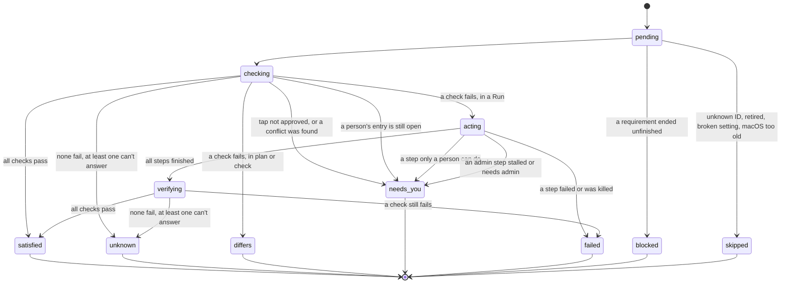

# Item lifecycle (prototype)

**Throwaway design answering [#12](https://github.com/nullaroni/soulcaster/issues/12). It isn't merged and it isn't the engine.** Nothing was installed and no `sudo` was run. Behavior on a real bare Mac is still unproven, so [Required spikes](#required-spikes) lists what has to run before this is trusted.

## Conclusion

Every Item goes through one pipeline: **plan, check, act, verify, record**. A step's exit code never counts as success. Only re-reading the Machine does.

| Question | Decision |
|---|---|
| States | `pending`, `checking`, `acting`, `verifying`, then one of `satisfied`, `unknown`, `differs`, `needs-you`, `failed`, `blocked` or `skipped`. |
| Things that can't be checked | `unknown` never triggers an action, never creates Drift and never joins the queue. |
| Dead settings | A clean read-back is `satisfied` with assurance `stored`, which is shown as "set", not "working". Only a toggle test for that macOS version in the Catalog upgrades it to `proven`. |
| Recipes | Data choosing from 8 closed step types and 9 closed check types built into the signed engine. No field can name a program, arguments or environment variables. |
| Order | Check everything, then the **Admin Stage**, then discard the password, then the **User Stage**. Third-party tap code only ever runs in the User Stage. |
| Base | `command-line-tools`, `homebrew` and `gh` are ordinary Catalog Items marked `base`, with no special path through the engine. |
| Early `gh` | **It works, with conditions.** GitHub's arm64 zip is signed, notarized and needs only system libraries. Run it with no `git` on `PATH`, because it calls `git` before signing in. Never use the unsigned `.pkg`. Not yet run on a bare Mac. |
| Failure | Recorded per Item with a kind. Only network errors retry automatically. Rerun always re-checks the Machine and never trusts the last record. |
| Progress | One typed event stream for both front ends. Passwords travel through a separate typed call, so an event can't carry one. |
| `sudo` | The parent's recommendation is adopted. One piece of the research doesn't work, though: **`sudo` closes inherited file descriptors before running the helper**, so the helper needs a per-step socket instead. |
| Machine Record | Decides Drift's direction, approvals, the queue and what needs admin next time. It never decides whether something is installed. |

Validation passed: all 22 recipes are accepted, and all 30 schema cases and 9 lint cases are refused. The state model ran 6,000 scenarios over the real recipes, and each of its 10 mutations was caught. Running it found 2 real problems, and writing it produced 3 more rules, listed under [What the model found](#what-the-model-found).

**Evidence labels**, as in the research: **Ran** means I ran it on this Mac, which already has Command Line Tools. **Read** means I read it in a primary source without running it. **Inferred** is my own conclusion, untested.

## 1. Steps and states

The engine exposes three calls. `plan` reads the Machine with no password and produces what the review before a Run shows. `run` executes an approved plan. `check` is `plan` reported as Drift.

1. **Resolve.** Follow Config to Catalog to recipe. Renames, retirement and unknown IDs behave as the Config draft says. A `broken` setting, or a Mac below `minMacOS`, ends `skipped` with a reason. A `skipped` reason about this Machine, such as `macos-too-old`, `managed-by-admin`, `broken-here`, `writes-through-link` or `marked-by-person`, is also the Config draft's **unavailable here** result: it's recorded per entry, shown apart from Drift, and never offers Adopt.
2. **Check (detect).** Run the recipe's checks. No check runs `brew`, so a check can't load tap code: Homebrew state comes from reading `Cellar`, its install receipts and `Caskroom`.
3. **Act.** Run steps in order. A step whose `unless` check passes is skipped. A needs-you step stops the Item there, and other Items carry on.
4. **Verify.** Run the same checks again. A setting is verified after its batched restart, because a running app can overwrite a write ([settings research](https://github.com/nullaroni/soulcaster/blob/research/macos-settings/docs/research/macos-settings.md)).
5. **Record.** Write the result to the Machine Record as soon as the Item finishes, so a crash loses at most one Item.
6. **Report Drift.** `check` compares the Config, the Machine and the last-applied record later on.



A new Run starts every Item again at `pending`, so no terminal state carries over and blocks a retry.

| State | Meaning | Offers |
|---|---|---|
| `satisfied` | All checks pass. Carries an assurance, below. | Nothing |
| `unknown` | No check fails, and at least one can't answer, such as a probe that was refused or timed out. | Show it. Never act on it. |
| `differs` | A check fails. Appears only in `plan` and `check`, because a Run acts on it. | Apply or Adopt, as Drift |
| `needs-you` | Only a person can continue. | The queue entry |
| `failed` | A step failed, or verify disagreed with it. | Retry, with the log |
| `blocked` | A requirement ended anything but `satisfied` or `unknown`. Names which one. | Clears when that does |
| `skipped` | Deliberately not attempted, with a reason. | Depends on the reason |

### Checks that can't answer

A recipe has two kinds of read:

- **`checks`** gate the Item. `unknown` here makes the Item `unknown`.
- **`facts`** are reported and never gate anything. This is where sign-in status lives.

| Case | How it's modeled | Result |
|---|---|---|
| Junie sign-in | Fact with an `unknowable` check | Item is `satisfied`. Report says "Signed in: can't be checked". |
| Claude Code, Codex, opencode sign-in | The same. They could be probed, but agent CLIs are install-only, and `opencode` may start a background server when run. | Same as Junie, so the four agent CLIs read alike. |
| Xcode: App Store sign-in | Fact, plus a needs-you step that completes when Xcode appears | The engine never needs to know. It checks for the result. |
| Xcode: Apple Account inside Xcode | Fact | Report only |
| AeroSpace's Accessibility permission | Fact, plus a needs-you step the person confirms | macOS 27 hides this, so the record says who confirmed it, not that it's on. |
| A defaults key forced by an admin profile | `CFPreferencesAppValueIsForced` | `skipped`, reason `managed-by-admin`. Never Drift. |

### Settings that read back but may be dead

A read-back proves storage, not effect, and nothing at run time can tell the difference. So:

- **`satisfied` carries an assurance.** `proven` means the check observes the real thing, or this key has a toggle-and-diff result for this macOS version in the Catalog's `confirmedOn`. `stored` means the value reads back and nothing more.
- **`confirmedOn` starts empty.** Nothing has been toggle-tested yet, so every setting starts as `stored`. Only a Catalog release can raise it.
- **The UI says "Set", not "Working".** Drift can say a value matches, never that it works.

| Evidence group | Selected in a Config | Reported as |
|---|---|---|
| `documented`, `probable` | Written, restarted, read back | `stored`, or `proven` if confirmed on this macOS version |
| `unconfirmed` | Written, restarted, read back | `stored`, labeled "effect not confirmed" |
| `broken` | Not written | `skipped`, with the Catalog's message |

**Unset isn't false.** If a recipe declares `unsetMeans`, an unset key compares as that value. Otherwise `check` reports `unknown`, with no Drift, and a Run still writes what the Config asks for.

## 2. Recipes

A recipe has no way to express a program. The engine holds the implementations, each with a fixed program, argv and environment, with no shell and stdin at `/dev/null`. **A new step or check type needs an engine release, which is the reviewable boundary.** The engine's own `git` always runs with `GIT_CONFIG_GLOBAL=/dev/null` and `GIT_CONFIG_NOSYSTEM=1`, and any shell with `zsh -f`, because a linked `~/.gitconfig` or `~/.zshenv` runs code as soon as they start (Ran, in the Config draft's check). `git config --file` reads and writes the global config directly, without running its contents. See [`recipe.schema.json`](recipe.schema.json) and [`recipes-examples.json`](recipes-examples.json).

| Step type | What the engine does |
|---|---|
| `brew-formula` | `brew install <name>`, with `HOMEBREW_NO_SUDO=1`. Never privileged. |
| `brew-cask` | `brew install --cask <name>`. `admin` is allowed only for official casks. |
| `download` | Fetch, check SHA-256, extract, check signer, then move atomically into Soulcaster's tools folder. The recipe can't choose the destination. |
| `pkg-install` | Fetch, check SHA-256 and signer, run `/usr/sbin/installer` under `sudo -A`. Always admin. |
| `sdkmanager` | Run the cask's `sdkmanager` with a fixed SDK root and `JAVA_HOME`. |
| `accept-license` | Wait for a person to accept in the queue, record it, then perform the acceptance for that license. |
| `needs-you` | Show text and an optional link. Completes when the person confirms, or when a check passes. |
| `builtin` | `command-line-tools`, `gh-hand-off`, `xcode-first-launch`. |

The check types are `brew-formula`, `brew-cask`, `app-bundle`, `pkg-receipt`, `file`, `managed-tool`, `tool-version`, `builtin` and `unknowable`. Only `tool-version` runs third-party code, and only a binary the Item installed, with one of three fixed flags.

**Three closed lists do real security work:**

- **Git keys.** `core.sshCommand`, `core.pager`, `core.hooksPath`, `core.fsmonitor`, `credential.helper` and `alias.*` all run programs, so a free-form key would be a shell in disguise.
- **`defaults` domains.** This keeps out login hooks. It also keeps out `com.apple.spaces`, because of the WindowServer warning in the settings research.
- **Restarts.** Dock, Finder, SystemUIServer and ControlCenter. `cfprefsd` isn't on the list.

### The hard cases

| Case | Recipe | Notes |
|---|---|---|
| Homebrew cask | `ghostty`: one `brew-cask` step and a `Caskroom` check | The engine reads official casks' JSON metadata when planning. A `pkg` artifact or `sudo: true` makes it admin, whatever the recipe says. `installer manual:` makes it needs-you. |
| Third-party tap formula | `maestro`: fully qualified name in the step and check. The engine generates this same recipe for a name in a Config's `packages`. | Installing by full name trusts only that formula ([Tap Trust](https://github.com/Homebrew/brew/blob/88f401fb862a12a0a5a201f189de570efc2a9ff1/docs/Tap-Trust.md), Read). **Today's `packages.sh` trusts whole taps, and this drops that.** It needs a tap approval in the Machine Record, or it ends `needs-you`. |
| Kotlin LSP | `kotlin-lsp`: `download` with SHA-256 and signer `2ZEFAR8TH3` | **The URL in `scripts/kotlin-lsp.sh` returns 404 today** (Ran), so it now pins 263.7084.0. I downloaded that build: the SHA-256 matches JetBrains' published value, it's a zip despite the `.sit` name, and `intellij-server` is Developer ID signed (Ran). It moves out of `/opt/homebrew/opt`, which Homebrew owns. `xattr -c` is gone because the engine's download isn't quarantined. Its link is in `~/.local/bin`, and putting that on `PATH` is left to the Dotfiles Repo. |
| Android SDK | `android-sdk`: cask, `accept-license`, then `sdkmanager` with fixed package names. `android-emulator` is a separate Item. | The Config draft dropped `android.*`, because moving from 35 to 36 leaves both installed, so one value can't describe the Machine. The Catalog pins the platform and build tools. **Today's script doesn't look like it works on a bare Mac:** Google's installer drops an `android` binary into `~/.local/bin` and runs it once (Read, and I didn't run it, so what that first run fetches is unknown), and nothing installs Java. So this uses Homebrew's `android-commandlinetools` cask and requires `openjdk`, shown in the review as pulled in by `android-sdk`. |
| Tailscale | `tailscale`: admin cask, `conflicts`, and a note | Conflicts catch the App Store copy and the formula, whose pre-install dialogs would stall a Run. Install-only, so approval and sign-in are a note, not a queue entry. See [spike 8](#required-spikes): the vendor's own post-install runs `open -a`, so Soulcaster not starting it may not mean it doesn't start. |
| Full Xcode | `xcode`: needs-you, `accept-license`, `builtin`, the last two admin | **The App Store by hand, not `mas`.** See below. |
| Dock setting | `dock.autohide`: `stores` is the read and write path, `effect` is `restart-dock` | Writes in a group, one restart, then verify all of them. There are no steps to write. |
| Git identity | `git-identity`: `machine-values` naming two values and their Git keys | Filled without asking, in this order: existing `git config`, the local file, the GitHub account, then the queue. A Run never prompts for it. Values live in the Machine Record. Requires `command-line-tools`, because `/usr/bin/git` is a stub until then. |

**Xcode by hand instead of `mas`, which departs from the tool-installs research.** `mas` calls `/usr/bin/sudo` without `-A` (Read), so it can't use the helper. The engine would have to run `mas` itself as root and hold the password open through a download of several gigabytes. Xcode already needs a person before its download starts. Sending them to the App Store's Get button removes that exposure, drops a dependency, and turns "are you signed in?" into "has Xcode appeared?", which the engine can actually check. The privileged part shrinks to the short first-launch step.

## 3. Dependencies and order

**Only selected Items and the three base Items are installed, plus whatever those require.** A selected setting's `requires` counts too, so `dock.apps` pulls in `dockutil`. `requires` is a hard ordering edge between Items. Anything required is pulled into the plan and labeled in the review with why it's there. The Machine Record notes it was pulled in, so Adopt doesn't treat it as a choice.

### A Run on a bare Mac

```text
Before the Run   Pick a Config and review the plan. Sign in first if the Config Repo is private.
First minute     Preflight, read-only: arm64, macOS version, admin group, Touch ID, network
                 Download the bootstrap gh in the background
                 Secure prompt for the sudo password, validated by one sudo call
                 GitHub sign-in: show the code, open the browser
Person leaves    caffeinate holds the Mac awake
Admin Stage      command-line-tools -> homebrew -> admin casks such as tailscale
                 Password discarded, even if everything here failed
User Stage       gh (hand-off) -> official formulae and casks -> downloads -> settings,
                 with one restart per group -> approved third-party tap Items ->
                 Dotfiles clone and links at the approved commit -> Git settings and identity ->
                 Dotfiles script
End              Report, the Needs-You Queue, and the offer to log out if a setting needs it
```

If the `softwareupdate` route fails, the `command-line-tools` builtin falls back to Apple's dialog and the Item waits in the queue until its check passes. Homebrew and everything needing it are then `blocked`, the password is discarded, and settings and direct downloads carry on.

Rules that make this hold:

1. **Check every Item before assigning stages.** Otherwise an Item that's already fine looks unfinished to something in an earlier stage. The model found this.
2. **Stage is computed.** An Item is in the Admin Stage only if it would reach an admin step with no open person-gate before it. So Xcode on a first Run stops at its gate and holds nothing open.
3. **An admin Item may require only other admin Items.** Otherwise it waits for a stage that runs after the password is gone. Lint enforces this.
4. **Every step's effect must be visible to a check,** or a rerun won't redo it. The model found this too.
5. **Dotfiles links run before Git settings, and only after the password is gone.** If `~/.gitconfig` is a linked file, the engine won't write through it, because identity would land in the Dotfiles Repo. Those entries end `skipped` with reason `writes-through-link`. `gh auth setup-git` follows the same rule: it's skipped and reported if the file resolves into the repo.

### Does the early `gh` work on a bare Mac?

**Yes on the evidence available, but it has not been run on a bare Mac** ([spike 6](#required-spikes)).

| Question | Finding | Basis |
|---|---|---|
| Is there a suitable asset? | `gh_2.103.3_macOS_arm64.zip`, 14.1 MB, in the 2.103.3 release from 2026-10-26. Its SHA-256 matches both `checksums.txt` and GitHub's asset digest. | Ran |
| Can a bare Mac run it? | Thin arm64. Links only `libSystem`, `libresolv`, `CoreFoundation` and `Security`. No Command Line Tools needed. | Ran |
| Is it trustworthy? | Developer ID Application: GitHub (`VEKTX9H2N7`), Hardened Runtime, passes `codesign --check-notarization`. | Ran |
| Can the `.pkg` be used? | **No.** `pkgutil` says "no signature", `spctl` rejects it, and it needs root. | Ran |
| Does it sign in without a terminal? | Yes. With no TTY it prints the code and `Open this URL to continue in your web browser: https://github.com/login/device`, without waiting for Enter. I stopped before approving anything, and nothing was stored. | Ran |
| **Does sign-in touch `git`?** | **Yes.** Even without a TTY it runs `git config credential.https://github.com.helper` and `git config credential.helper` before asking, for its telemetry, and it still does with `GH_TELEMETRY=false`. A fake `git` on `PATH` logged both calls. On a bare Mac `/usr/bin/git` is the stub, so this could raise the Command Line Tools dialog in the first minute. | Ran; dialog Inferred |
| Is that avoidable? | Yes. With `PATH` pointing at an empty folder, sign-in worked the same. `--clipboard=false` stops it calling `pbcopy`. | Ran |
| Where does the token go? | `/usr/bin/security` by absolute path, so an empty `PATH` is fine. It adds the item with no `-T`, so access follows that tool and not `gh`. | Read ([`go-keyring`](https://github.com/zalando/go-keyring/blob/v0.2.8/keyring_darwin.go)) |

**How it's fetched.** The version, URL, SHA-256 and Team ID come from the `gh` recipe's `bootstrap` block, which ships inside the signed release. Using a pin avoids GitHub's rate-limited API on a bare Mac and keeps the parsed output stable for that version. The engine extracts with `ditto -x -k`, verifies the signature and Team ID, and keeps it in Application Support, never on the user's `PATH`.

**How it's run:**

```text
env -i HOME=... PATH=<empty folder> GH_PROMPT_DISABLED=1 GH_TELEMETRY=false GH_NO_UPDATE_NOTIFIER=1
  <bootstrap gh> auth login --web --clipboard=false --hostname github.com --git-protocol https --skip-ssh-key
```

**The hand-off** is the last step of the `gh` Item, in the User Stage. If `gh` is already on the Machine and working, none of this runs.

1. `brew install gh`. The token and `~/.config/gh/hosts.yml` are shared, so there's no second sign-in (Inferred, [spike 6](#required-spikes)).
2. Check that Homebrew's `gh` reports the same account, then use it from now on.
3. Run `gh auth setup-git` **only with Homebrew's `gh`, with `GH_PATH=/opt/homebrew/bin/gh`.** That command writes an absolute path into `~/.gitconfig` (Read), so from the bootstrap copy it would leave a helper pointing at a deleted file. If another credential helper is already set for GitHub, leave it and say so.
4. Delete the bootstrap copy. The `gh-handed-off` check makes this step run again if a crash interrupts it.

If Homebrew or the formula fails, the engine keeps using the bootstrap copy for this Run and the next, and the `gh` Item shows `blocked` or `failed`. The bootstrap copy reads Config Repos through `gh api`, which needs no `git`. If the sign-in itself fails, Items needing GitHub are `blocked` and the rest continue, with sign-in in the queue. If `gh` falls back to a plain-text token because Keychain refused it, the report says so.

## 4. Failure, retry and rerun

Every `failed` Item records its step, kind, exit code, a log reference and what would fix it.

| Kind | Example | Automatic retry | Fix |
|---|---|---|---|
| `network` | Timeout, or a 5xx | 2 more, after 30 seconds then 2 minutes | Rerun |
| `not-found` | A pinned URL now returns 404, as Kotlin's does | No | Update Soulcaster |
| `checksum`, `signature` | Mismatch | **Never** | Update Soulcaster, and it's flagged as a possible attack |
| `tool-exit` | `brew` exited non-zero | No | Rerun, with the log |
| `verify` | The step said yes and the checks say no | No | Rerun, with the log |
| `stalled` | No progress within the step's limit, so its process group is killed | No | Admin step: `needs-you`, because something may be waiting on a person. Otherwise `failed`. |
| `needs-admin` | `HOMEBREW_NO_SUDO=1` rejected a cask after the password was gone | No | `needs-you`. The Machine Record remembers it, so the next Run puts it in the Admin Stage. A third-party Item instead asks the person to install it themselves. |
| `interrupted` | Crash or power loss. Written at next launch for anything unfinished. | No | Rerun |

**Rerun has one rule: check the Machine, then act only on what fails.** The record is never used to skip work, because the Machine may have changed. Steps are safe to repeat, since `brew install` is idempotent and `download` swaps atomically.

**A retry is a smaller Run.** Pressing Retry, or finishing a queue entry, starts a Run scoped to that Item, everything waiting on it, and whatever unfinished Items it needs. So there's one path instead of a separate retry path.

**The queue is durable.** Entries live in the Machine Record. An open entry a person must finish holds its Item at `needs-you` even if its checks pass, so a full rerun can't quietly close "Allow AeroSpace under Accessibility". Entries caused by a stall or missing admin close when a retry succeeds.

Only one Run happens per Machine, enforced with a lock. Items run one at a time.

## 5. Progress and what's kept

The engine is a library inside the one binary. Both front ends call the same `run` and subscribe to the same stream.

**Asks aren't events.** A front end implements a small typed interface: ask for the password (returning a type that zeroes itself and can't be serialized), show the GitHub code and URL, and report sign-in status. So a secret has no path into the event stream or a log.

| Event | Carries | Delivery |
|---|---|---|
| `run.started` | Run ID, scope, Config reference and commit, Catalog and engine versions, macOS version, plan | Lossless |
| `ask.state` | `password` or `github`, and `waiting`, `done` or `skipped` | Lossless |
| `admin.held`, `admin.discarded` | Why and when. Never the password. | Lossless |
| `item.state` | Item, from, to, assurance, failure kind, blocked-by | Lossless |
| `item.step` | Item, step index, type, started or finished | Lossless |
| `item.progress` | Item, phase, bytes done and total if known | May be merged |
| `item.log` | Item, stream, a batch of lines | May be merged and capped |
| `queue.opened`, `queue.closed` | Entry ID, Item, kind, text, link | Lossless |
| `run.warning` | Such as Touch ID being on, or a plain-text token | Lossless |
| `run.finished` | Counts per state, and the queue | Lossless |

Each has a schema version, a sequence number and a timestamp.

- **Rune UI.** Rune wakes on every `handle.update`, so the engine batches `item.log` and `item.progress` about every 100 ms. State events go straight through. The engine thread never blocks on the UI.
- **CLI.** Line-oriented text by default, or `--json` for one event per line. It reads the password from `/dev/tty` with no echo, and uses the same helper as the UI. Exit codes: `0` everything finished, `2` refused before changing anything, `3` finished with queue entries, `4` finished with failures.

**Kept after a Run**, under `~/Library/Application Support/Soulcaster/`, in a folder only the user can read:

```text
machine.json                the Machine Record, written atomically
runs/<run-id>/run.json      summary and final state of every Item
runs/<run-id>/events.ndjson the lossless events
runs/<run-id>/logs/<item>.log
```

Logs are capped at 10 MB per Item, and the last 20 Runs are kept. Local values are never logged, only their names, and token-shaped text is masked. Nothing leaves the Machine.

## 6. `sudo`

The parent's recommendation is adopted: give the helper only to the steps that need it, never to steps that load third-party taps, and discard the password as soon as those steps finish. I found no problem with it. Enforcing it does need a different helper than the research sketched.

**The research's transport won't work.** It suggested an inherited pipe or socket. `sudo_askpass` calls `closefrom(STDERR_FILENO + 1)` before running the helper, and stdout is sudo's own pipe (Read, [`tgetpass.c`](https://github.com/apple-oss-distributions/sudo/blob/802f972bdc92b5d54dea338bfcc1ac7ad30d1ef6/sudo/src/tgetpass.c)). So nothing above fd 2 reaches it. `bin/brew` also filters the environment, keeping `SUDO_ASKPASS` and `HOMEBREW_*`.

**The design instead** (Inferred, [spike 1](#required-spikes)):

- Each admin step gets a private folder holding a socket and a symlink to the signed helper. `SUDO_ASKPASS` points at the symlink. sudo passes that path as `argv[0]`, so the helper finds the socket beside it.
- **The socket exists only while an admin step runs.** Between steps, and during a long `brew fetch`, nothing answers.
- The engine checks the peer's code signature, and answers within a per-step budget: **one answer** for the engine's own `sudo -A` calls, so `softwareupdate` runs on with the socket closed, and as many as needed during a `brew` cask, which resets its timestamp.
- The password is locked in memory, zeroed on discard, and never in a file, argument, environment variable, event or log. Core dumps are off.

**This doesn't remove the main limit.** While a socket is open, any code running as this user can start `sudo -A` with that path and get root. The design makes the window short and stops the password itself leaking. The window still exists.

| Question from the ticket | Decision |
|---|---|
| **When is the password discarded?** | When the last Admin Stage Item reaches a terminal state, including when all of them failed. Also on quit, or after a 60-minute cap, when remaining admin Items go to the queue. It's never kept for a later Run. |
| **How are third-party taps handled?** | Never while the password is held. No tap is tapped and no third-party name is passed to `brew` until after the discard. They run with `HOMEBREW_NO_SUDO=1` and no `SUDO_ASKPASS`. A third-party cask that needs `sudo` goes to the queue for the person to install. It never gets the helper, and the schema and lint both refuse a recipe that tries. The Dotfiles install script gets the same treatment. |
| **What about taps already on the Machine?** | Accepted. That code could already reach the same window like any other same-user code, so singling it out adds nothing. The Admin Stage sets `HOMEBREW_NO_AUTO_UPDATE=1`, so those clones can't pull new code during the window. |
| **Touch ID for `sudo`?** | Detect it read-only by looking for an active `pam_tid.so` line in `/etc/pam.d/sudo_local` and `/etc/pam.d/sudo`, both world-readable (Ran). Warn in the review: "stay nearby for the first part". Every admin step has a stall limit, and if it trips, the Item goes to the queue and the Run continues. Never edit those files. [Spike 3](#required-spikes) decides whether this is enough. |
| **Standard, non-admin accounts?** | Detected with `id -Gn`, without touching sudo. If Command Line Tools or Homebrew are missing, **refuse before changing anything** and say an admin must set those up once. If they're there, run with no password prompt: admin Items and app casks go to the queue, because `/Applications` isn't writable, and formulae and settings proceed. |
| **Wrong password?** | Validate once in the first minute with `sudo -k`, then `sudo -A -v`, with a budget of one answer. sudo would otherwise retry (three tries by default), which could lock an account. Ask again in the prompt, without starting the Run. |

**How the owner's "always asks" rule applies.** A full Run always asks, as decided. If its plan has no admin steps, the engine validates and discards at once. A Run scoped by Retry or a queue entry asks only if it has admin work. See [Decisions to overrule](#decisions-the-owner-may-want-to-overrule).

## 7. What the Machine Record decides

**The rule: the Machine decides what is true, and the record decides what it means.**

| Question | Decided by |
|---|---|
| Is it installed? Does the value match? | **Checks only, never the record** |
| Which side moved? | The record's last-applied value, using the table in the [prior-art research](https://github.com/nullaroni/soulcaster/blob/research/prior-art/docs/research/prior-art.md) |
| Was this dropped from the Config? | An entry in the record that's no longer in the Config |
| May this tap or script run? | The record's approvals. A missing one sends the Item to `needs-you`. |
| Is a queue entry still open? Was a license accepted? | The record |
| Does this need the Admin Stage, against what the Catalog says? | The record's learned-admin list |
| Was this installed for another Item? | The record's pulled-in list |

`unknown` and `stored` also shape Drift: `unknown` is never Drift, and a `stored` match says "matches", never "working".

**What this needs from the Machine Record in the Config draft**, extending its section 5:

| Field | Requirement |
|---|---|
| `lastApplied[entryKey]` | Keyed with the draft's spellings: Item ID after renames, `formula:<name>` after aliases, `cask:<name>`, setting ID, link location. A package that later gains an Item migrates to the Item's key at read time. Holds the value, `appliedAt`, Run ID, Catalog version, macOS version, assurance and `priorValue`. **Updated only after a verify passes.** `priorValue` is captured before the first write and kept. |
| `approvals` | The draft's keys: `owner/tap`, `owner/tap/name`, and for the `dotfiles` block the repo plus commit SHA, with whether its script is approved. The engine never pulls past that commit without a new preview. |
| `unavailable{}` | Per entry, or per tile in a list setting: the reason it can't apply here. It can suppress an entry but never add or change one. |
| `unknownAtReview[]` | IDs shown as unknown when this Config was last reviewed. One that later resolves is held for review as a new selection, not installed. |
| `localValues` | Git identity and any other Catalog-declared values. Never logged. |
| `queue[]` | Item, step ID, kind, opened and finished times, and who finished it. |
| `accepted[]` | License and time. |
| `learnedAdmin[]`, `pulledIn{}` | As above. |
| `follows` | Config Repo, path, commit last read. |
| `clonePath` | The Dotfiles Repo's location. |

Writes must be atomic and happen after every Item. The record is never Adopted and never sent anywhere. When a Machine switches Config, `lastApplied` stays, which is how entries become "no longer in this Config". [#13](https://github.com/nullaroni/soulcaster/issues/13) still owns conflict behavior and [#15](https://github.com/nullaroni/soulcaster/issues/15) the approval screens.

## What the model found

[`model.py`](model.py) runs the lifecycle over the real recipes, and it did change the design. It's a simplified simulation with no real processes. Its crashes land only between Items or between an Item's first two steps, and 6,000 random scenarios aren't exhaustive.

**Running it found two problems in what I'd written:**

1. **A satisfied requirement could look unfinished.** On a rerun where Command Line Tools were fine and Homebrew had failed, Homebrew ran in the Admin Stage first and saw its requirement still `pending`, so it was wrongly `blocked`. That's why every Item is now checked before stages are assigned.
2. **A crash could strand the bootstrap `gh`.** With only a `brew-formula gh` check, a crash between `brew install gh` and the hand-off left a passing check, so the hand-off never ran again. That's why `gh-handed-off` exists, along with the rule that every step's effect must be visible to a check.

**Changing the recipes later exposed one mistake in the model itself.** With `android-emulator` requiring `android-sdk`, a requirement could reach `needs-you` after its cask landed. Blocking on it is right, but invariant I6 wrongly called it unjustified, so I6 now mirrors the blocking rule.

**Writing it produced three more rules,** before they could fail, and the mutations now show what breaks without them:

- An open entry holds its Item, because AeroSpace's cask check passes while Accessibility is still open, and a full rerun would otherwise close the entry.
- A surprise `sudo` need loops forever unless it's remembered, hence `learnedAdmin`.
- A retry of one Item must reach both what it needs and what's waiting on it.

## Left out deliberately

| Left out | Why |
|---|---|
| Parallel installs | Homebrew holds its own locks, and serial order makes logs and failures simple. Add later if Runs prove too slow. |
| A background service | The app runs Runs while it's open. Updates run only when the user chooses, so nothing needs to run unattended later. |
| Uninstall and rollback | Removal needs explicit confirmation, and belongs with Drift in #13. `priorValue` is kept so it can be offered. |
| Outdated versions | Separate from Drift, per the prior-art research. "Update all" is its own feature. |
| Resuming inside a step | Steps are repeatable, so rerunning is enough. |
| Polling while a person works | The queue has a check-again button. |
| Running agent CLIs to read sign-in status | Install-only, and it may leave processes behind. Adding one is a new check type and a Catalog line. |
| Hoisting user Items into the Admin Stage | Lint refuses that shape, and no real Item needs it now that Xcode doesn't use `mas`. |
| Vendor `curl \| sh` installers | See below. |
| Catalog fields `renamedTo`, `deprecated`, `retired`, `coversPackages`, `conflictsWith` | Owned by the Config draft, whose stub adds them to these recipes and passes this schema without them. They'd be added to this schema when the two merge. |

## Rejected alternatives

| Alternative | Why not |
|---|---|
| Shell commands in the Catalog, since it's reviewed and signed | The Catalog takes community pull requests. A reviewer can't reliably reason about a script's effects, and a shell step gives no read path for Drift. ADR 0001's reasoning carries over. |
| A `vendor-script` step with a pinned checksum | Vendor scripts edit shell startup files and change without notice, and a hash pin breaks on every release. The cost is real: see the overrule list. |
| Trusting exit codes | Today's scripts report success after `\|\| true`. The prior-art research found the same complaint against winutil. |
| `stored` as a separate terminal state | Nothing branches on it. It's a property of `satisfied`, not a different lifecycle. |
| A separate retry path | Two ways to do the same thing would drift apart. A retry is a scoped Run. |
| `mas` for Xcode | See section 2. |
| Holding the password until the Run ends | Third-party taps and Dotfiles scripts would run inside the window. |
| Running the bootstrap `gh`'s `auth setup-git` | It writes that copy's absolute path, which is then deleted. |
| Asking GitHub for the latest `gh` | Unauthenticated API limits, a changing binary with nothing pinned to check, and output we haven't tested. |

## Decisions the owner may want to overrule

Each is decided so work can continue. **[security]** or **[cost]** says why it's flagged.

1. **[security] Root is reachable during admin steps.** Any same-user code can get root while an admin step's socket is open. This follows from your decision to hold the password, and it's as narrow as I could make it.
2. **[security] A full Run with no admin work still asks for the password.** I followed your rule, then validate and discard. **I'd change this** to skip the prompt, since asking for a password nothing needs teaches people to type it.
3. **[security] A scoped Run asks only if it has admin work.** This is the one place I read "always asks" narrowly, because otherwise every Retry would prompt.
4. **[security] Third-party tap Items never get the helper.** A tap cask with a `.pkg` always falls to the person, which costs some hands-off installs.
5. **[security] 60-minute cap on holding the password.** A very slow link could push admin casks into the queue. Lifting the cap lengthens the window.
6. **[security] `gh` is pinned by checksum and Team ID in the signed Catalog,** and doesn't follow GitHub's latest. If GitHub ever removes that asset, sign-in falls to the queue until a new release.
7. **[security] The default GitHub token has `repo`, `read:org` and `gist`.** `repo` is full access to private repos. That's `gh`'s minimum, and the usual state for a `gh` user, but Soulcaster is what requests it.
8. **[security] The engine runs `gh auth setup-git`,** which changes `~/.gitconfig`. It leaves an existing GitHub helper alone, and skips the step if that file is a link into the Dotfiles Repo.
9. **[security] Accepting licenses takes one click in the queue,** after which the engine answers `sdkmanager --licenses` or runs `xcodebuild -license accept`. A Config can never accept for someone.
10. **[security] Unconfirmed settings are applied and labeled, not excluded.** The other option from the research is to leave them out until a toggle test passes. I kept them because the person selected them and `stored` tells the truth about them.
11. **[security, cost] No vendor installers at all.** Junie comes from the official `junie` cask (3959.5 on 2026-11-06, from JetBrains' GitHub releases), not `jetbrains/junie/junie` (still 3110.7, the same vendor's asset behind a self-updating shim), so it needs no tap approval. Claude Code and Codex use casks, not vendors' recommended scripts. Android uses the cask. This keeps the sync model and avoids edits to shell startup files. The cost is lag and departing from what vendors recommend.
12. **[cost] Xcode through the App Store by hand,** departing from the research's `mas` recommendation. It's one more manual click, and it can't choose an Xcode version.
13. **[cost] Pinned direct downloads will rot.** Kotlin's old pin is already a 404, and JetBrains calls these pre-alpha weekly builds. The Item fails until the next Soulcaster release, and the rest of the Run is unaffected. The `jetbrains/utils` tap is the alternative, with its lag and a tap approval.
14. **[cost] Kotlin LSP moves out of `/opt/homebrew/opt/kotlin-lsp/libexec`.** Your Dotfiles Repo may point at the old path. I couldn't check it.
15. **[cost] Standard accounts are refused when the base is missing,** rather than guiding them through asking an admin. That's the first-run ticket's call if it wants more.

## Required spikes

Each runs on a clean Mac or VM, per [#9](https://github.com/nullaroni/soulcaster/issues/9). The first five are from the unattended-run research, extended where this design depends on them.

| # | Spike | Decides |
|---|---|---|
| 1 | `brew install --cask <pkg cask>` from a GUI process with no terminal, using the per-step socket and symlinked helper. Count helper calls. Confirm `argv[0]`, the fd closing and the peer signature check. | Whether the helper design works at all. **Do this first.** |
| 2 | The `softwareupdate` placeholder route on bare macOS 27, including with the screen locked | The `command-line-tools` builtin, and when it falls back to the dialog |
| 3 | Enable `pam_tid.so` and repeat spike 1. Does sudo wait, for how long, and does it fall through to the helper? | Whether a stall limit is enough for Touch ID |
| 4 | Upgrade an app from a GUI-launched `brew`. Which app does the App Management prompt name, and does `brew` block? | Apply on a Machine in use |
| 5 | Open each `Privacy_*` link on macOS 15, 26 and 27 | The links in needs-you steps |
| 6 | **Bare-Mac `gh`, end to end.** Download, sign in with an empty `PATH`, and confirm no Command Line Tools dialog. Install Homebrew's `gh` and confirm it reads the token with no Keychain prompt. Check the helper line `setup-git` writes. Delete the bootstrap copy. Force the plain-text fallback. | The early-`gh` plan |
| 7 | `Homebrew.pkg` under `sudo -A installer` with no terminal, then `brew install` with `HOMEBREW_NO_AUTO_UPDATE=1` on a fresh install. Confirm which user it picks. | The `homebrew` recipe |
| 8 | Install `tailscale-app` with no terminal. Does its post-install launch the app, raise prompts or stall? | Whether "doesn't start it" is achievable, and how the note should read |
| 9 | Toggle-and-diff each setting on each macOS release. Confirm the restart and read-back order, including Dock rewriting a value. | `confirmedOn`, and the order in section 1 |
| 10 | Xcode: `xcodebuild -checkFirstLaunchStatus`, `-license accept`, `-runFirstLaunch` and `xcode-select -s`. This Mac has no Xcode. | The `xcode-ready` check and `xcode-first-launch` |
| 11 | `sdkmanager` from the cask with `openjdk`, with stdin at `/dev/null`, then the license flow. Does `intellij-server` run through a symlink, and does it answer `--version`? | `android-sdk` and `kotlin-lsp`. The `--version` check comes from today's script and I didn't run it. |
| 12 | A real Run through sleep, display off and a locked screen, in a Rune app | `caffeinate` and App Nap, and whether the app survives |
| 13 | How Homebrew words a `HOMEBREW_NO_SUDO` rejection, and `gh`'s sign-in lines, against the pinned versions | Classifying `needs-admin`, and parsing the code |
| 14 | A Rust JSON Schema validator against these patterns | Build-time schema checks. The Config draft's check compiled this schema's patterns with Rust's plain `regex`, and the draft's own schema agreed across Rust, Ajv and Python. Recipes haven't been validated in Rust. |
| 15 | With a hostile `~/.gitconfig` in place, `brew tap` and `brew install` during an Admin Stage on a later Run. Does Homebrew's own `git` read it, with `SUDO_ASKPASS` visible? | Whether already-linked dotfiles can reach the helper through Homebrew. The review didn't establish this, and it can't be run without changing Homebrew's tap folder. |

## Where this depends on the Config draft

The [Config format](https://github.com/nullaroni/soulcaster/blob/prototype/config-format/docs/prototypes/config-format/README.md) was independently reviewed, and both designs were updated together. This design uses its Item and setting ID grammar, package name grammar, entry key spellings, approval keys, and the boundary in its section 5. If those change, the examples and the record fields change with them, and the lifecycle doesn't.

**What that draft took from this one:**

- **`gh-sign-in` and `tailscale-sign-in` are deleted.** GitHub sign-in is a Run-level ask, and Tailscale is install-only. Nothing has shipped, so there are no IDs to retire.
- **Its stub uses this recipe format** in place of `install`, `apply` and `needsYou`, and its check validates the stub against this schema.
- **Tailscale's system extension stays a note,** not a queue entry, until [spike 8](#required-spikes) says otherwise.
- **Its open risk 6 is answered:** every setting has a read path here.

**What this design took from that draft:**

- **`android.*` is gone,** so `template`, `whenSetting` and `appliedBy` are gone from this schema, with fixed `sdkmanager` packages and an `android-emulator` Item instead.
- **Settings need bounds and a read path:** integer settings declare `minimum` and `maximum`, and `builtin` stores cover the values that aren't defaults or Git keys, such as `finder.show-library-folder`.
- **`junie` is the official cask.** Live Homebrew data showed it's current and needs no tap.
- **Dotfiles approval is repo plus commit, Git identity never asks, and "unavailable here" is recorded.** See sections 2, 3 and 7.

## Problems found in today's scripts

These matter for the port. None was fixed here.

- **`scripts/kotlin-lsp.sh`:** the pinned 262.7569.0 download returns 404, though its `.sha256` still returns 200 (Ran). A fresh Mac can't install it today.
- **`scripts/android.sh`:** the installer provides an `android` binary and runs it once (Read, not run), so `sdkmanager` is probably missing on a bare Mac and the script logs a skip. Nothing installs Java, and `|| true` followed by `log_ok` reports success regardless.
- **`scripts/packages.sh`:** `brew trust <tap>` trusts every current and future item in a tap. Homebrew's docs advise trusting specific items.
- **`scripts/xcode.sh`:** the wait loop never ends if the person dismisses the dialog.

## Validation

Run for real on 2026-11-06 with Python 3.9.6, `jsonschema` 4.25.1, Node 26.13.0 and Ajv 8.17.1. All tooling stayed in a temp directory. Run these from the repo root. They extract the scripts from this README, so what ran is what's shown:

```sh
TMP="$(mktemp -d)"
README=docs/prototypes/item-lifecycle/README.md
awk '/^```python$/{f=1;next} /^```$/{f=0} f' "$README" > "$TMP/check.py"
awk '/^```js$/{f=1;next} /^```$/{f=0} f' "$README" > "$TMP/check-ajv.mjs"

python3 -m venv "$TMP/venv"
"$TMP/venv/bin/pip" install --quiet --no-cache-dir jsonschema==4.25.1
"$TMP/venv/bin/python" "$TMP/check.py" docs/prototypes/item-lifecycle

npm_config_cache="$TMP/npm-cache" npm install --silent --no-audit --no-fund --prefix "$TMP/ajv" ajv@8.17.1
node "$TMP/check-ajv.mjs" "$TMP/ajv" docs/prototypes/item-lifecycle

python3 docs/prototypes/item-lifecycle/model.py

rm -rf "$TMP"
```

All three exit 0, and the model's output is the same whatever Python's hash seed. Each must-fail case makes one change to a recipe that passes, so that change is the only thing that can make it fail.

<details>
<summary>Output of <code>check.py</code></summary>

```text
schema: valid against the 2020-12 metaschema

== catalog: every hard case must pass the schema and lint
PASS 22 recipes pass the schema
PASS lint passes
PASS every hard case is present (12 checked)

== mustFailSchema: one change to a valid recipe, and the schema must refuse it
PASS shell-command-field: A recipe can't carry a shell command.
PASS shell-step-type: No step type runs a command.
PASS extra-arguments: Steps have no argument list.
PASS environment-variables: A recipe can't set the environment, including SUDO_ASKPASS.
PASS flag-as-package-name: A name can't be read as a flag.
PASS second-spelling-of-core: A bare name is the only spelling of an official package.
PASS download-without-checksum: Every download needs a SHA-256.
PASS download-without-signer: Every download needs an expected signer.
PASS download-over-http: Downloads are HTTPS only.
PASS url-carrying-a-command: A URL has no query or shell characters.
PASS download-chooses-its-destination: Only the engine picks where a tool goes.
PASS link-escaping-the-tool: A link target stays inside the tool's folder.
PASS version-check-runs-a-shell: tool-version takes one fixed flag.
PASS version-check-outside-allowed-roots: A check can't run system programs.
PASS path-climbing-out: A path can't climb out of its root.
PASS third-party-cask-as-admin: Third-party tap code never runs while the helper is live.
PASS git-key-that-runs-programs: core.sshCommand would run a program.
PASS git-alias: An alias can run a program.
PASS defaults-outside-allowed-domains: A recipe can't write login hooks.
PASS windowserver-warning-domain: com.apple.spaces stays out until the macOS 26 warning is cleared.
PASS restart-cfprefsd: Restarts are a closed list.
PASS setting-without-evidence: A setting must say how much its read-back proves.
PASS setting-without-read-path: A setting with no read path can't show Drift.
PASS integer-setting-without-bounds: An integer setting must say what's in range, so -5 can't be written.
PASS builtin-store-outside-the-list: Builtin read and write paths are a closed list.
PASS second-spelling-of-a-tap: jetbrains/homebrew-junie and jetbrains/junie are one tap, so only the short form is valid.
PASS item-without-read-path: An Item with no checks can't be verified.
PASS needs-you-file-link: A person link can't open a local file or run a script.
PASS unknown-builtin: Builtins are a closed list.
PASS bootstrap-on-a-selected-item: Only base Items may bypass Homebrew.

== mustFailLint: passes the schema but lint must refuse it
PASS unknown-requirement: ghostty: unknown requirement not-a-real-item
PASS requirement-cycle: gh: requirement cycle
PASS brew-without-homebrew: ghostty: a brew step must require homebrew
PASS git-without-command-line-tools: git-identity: Git stores must require command-line-tools
PASS admin-item-needing-a-user-item: xcode: an admin Item can't require openjdk, which runs after the password is gone
PASS pkg-install-in-a-third-party-recipe: maestro: an Item that loads third-party tap code can't use the helper
PASS pattern-with-lookahead: git.default-branch: a pattern must compile under Rust's plain regex, so no lookaround
PASS broken-setting-marked-confirmed: menu-bar.extras: can't be both broken and confirmed
PASS second-base-with-bootstrap: homebrew: only gh may bypass Homebrew

== stages: what the Catalog implies
can reach admin: command-line-tools, homebrew, tailscale, xcode
load third-party tap code, so never get the helper: aerospace, maestro
PASS no Item is in both lists

result: all checks passed
```

</details>

Ajv's output, using ECMA-262 regular expressions:

```text
catalog: 22 recipes accepted
mustFailSchema: 30/30 refused
mustFailLint: 9/9 pass the schema, as they should
```

<details>
<summary>Output of <code>model.py</code></summary>

```text
PASS recipes as written: 6000 random scenarios

mutations: each must trip an invariant
PASS discard-at-run-end: expected I3, got "I3 third-party tap code ran while the password was held: ['aerospace', 'maestro']" after 1 scenarios
PASS no-learned-admin: expected I11, got "I11 reruns never finished: ['ghostty', 'menu-bar.extras']" after 11 scenarios
PASS no-closure: expected I12, got 'I12 android-emulator stayed blocked after its requirements finished' after 7 scenarios
PASS trust-exit-code: expected I7, got 'I7 gh reported satisfied while its checks would fail' after 2 scenarios
PASS stop-on-failure: expected I1, got 'I1 android-emulator never reached a terminal state: pending' after 1 scenarios
PASS no-check-before-stages: expected I6, got 'I6 tailscale is blocked but no requirement ended badly' after 1 scenarios
PASS delete-bootstrap-at-end: expected I8, got 'I8 the Run ended with no working gh' after 2 scenarios
PASS ignore-open-queue: expected I10, got 'I10 aerospace became satisfied before a person finished grant-accessibility' after 7 scenarios
PASS gh-check-without-hand-off: expected I8, got 'I8 after convergence: bootstrap=True, active gh=bootstrap' after 3 scenarios
PASS admin-item-needing-a-user-item: expected I6, got 'I6 tailscale is blocked but no requirement ended badly' after 1 scenarios

result: all invariants held and all mutations were caught
```

</details>

**The `gh` checks** were one-off commands against the release assets, with `GH_CONFIG_DIR` and `HOME` in a temp folder and the process killed before any code was entered:

```text
$ shasum -a 256 gh_2.103.3_macOS_arm64.zip
d700207eae9ae98fe2b89535c2c087c07823d4628c56364695a5a07ef311c062
$ codesign -dvv gh   (excerpt)
Authority=Developer ID Application: GitHub (VEKTX9H2N7)
CodeDirectory v=20500 ... flags=0x10000(runtime)
$ codesign -v -R='notarized' --check-notarization gh
gh: explicit requirement satisfied
$ pkgutil --check-signature gh_2.103.3_macOS_universal.pkg
Status: no signature
$ env -i ... PATH=<fake git> gh auth login --web --clipboard=false ... </dev/null
! First copy your one-time code: XXXX-XXXX
Open this URL to continue in your web browser: https://github.com/login/device
[fake git logged] config credential.https://github.com.helper
[fake git logged] config credential.helper
```

### Check scripts

<details>
<summary><code>check.py</code></summary>

```python
#!/usr/bin/env python3
"""PROTOTYPE: validates recipes against the schema and the lint rules a schema can't express."""
import copy, json, pathlib, re, sys
from jsonschema import Draft202012Validator

root = pathlib.Path(sys.argv[1]).resolve()
schema = json.loads((root / "recipe.schema.json").read_text())
Draft202012Validator.check_schema(schema)
validator = Draft202012Validator(schema)
print("schema: valid against the 2020-12 metaschema")

def no_dupes(pairs):
    keys = [k for k, _ in pairs]
    dupes = {k for k in keys if keys.count(k) > 1}
    if dupes:
        raise ValueError(f"duplicate key {sorted(dupes)}")
    return dict(pairs)

doc = json.loads((root / "recipes-examples.json").read_text(), object_pairs_hook=no_dupes)
catalog = doc["catalog"]
by_id = {r["id"]: r for r in catalog["recipes"]}
failures = 0

def third_party(name):
    return name.count("/") == 2

def is_admin_step(s):
    return s["type"] == "pkg-install" or s.get("admin", False)

def lint(recipes):
    """Returns a list of problems. These rules span recipes, so a JSON Schema can't express them."""
    ids = {r["id"]: r for r in recipes}
    problems = []
    if len(ids) != len(recipes):
        problems.append("duplicate recipe ID")
    for r in recipes:
        rid, steps = r["id"], r.get("steps", [])
        reqs = r.get("requires", [])
        for q in reqs:
            if q not in ids:
                problems.append(f"{rid}: unknown requirement {q}")
        def reaches(start, seen=None):
            seen = seen or set()
            for q in ids.get(start, {}).get("requires", []):
                if q not in seen:
                    seen.add(q)
                    reaches(q, seen)
            return seen
        if rid in reaches(rid):
            problems.append(f"{rid}: requirement cycle")
        brew_steps = [s for s in steps if s["type"].startswith("brew")]
        if brew_steps and "homebrew" not in reaches(rid):
            problems.append(f"{rid}: a brew step must require homebrew")
        admin = any(is_admin_step(s) for s in steps)
        tap = any(third_party(s["name"]) for s in brew_steps)
        if admin and tap:
            problems.append(f"{rid}: an Item that loads third-party tap code can't use the helper")
        if admin:
            for q in reqs:
                if q in ids and not any(is_admin_step(s) for s in ids[q].get("steps", [])):
                    problems.append(f"{rid}: an admin Item can't require {q}, which runs after the password is gone")
        stores = list(r.get("stores", [])) + [v["store"] for v in r.get("values", []) if isinstance(v, dict)]
        if any(s["type"] == "git-config" for s in stores) and "command-line-tools" not in reaches(rid):
            problems.append(f"{rid}: Git stores must require command-line-tools")
        if re.search(r"\(\?[=!<]", r.get("pattern", "")):
            problems.append(f"{rid}: a pattern must compile under Rust's plain regex, so no lookaround")
        ev = r.get("evidence", {})
        if ev.get("group") == "broken" and ev.get("confirmedOn"):
            problems.append(f"{rid}: can't be both broken and confirmed")
        if "bootstrap" in r and rid != "gh":
            problems.append(f"{rid}: only gh may bypass Homebrew")
        gate_ids = [s["id"] for s in steps if "id" in s]
        if len(gate_ids) != len(set(gate_ids)):
            problems.append(f"{rid}: duplicate step ID")
    return problems

def pointer_parts(path):
    return [p.replace("~1", "/").replace("~0", "~") for p in path.lstrip("/").split("/")]

def apply_patch(recipe, patch):
    out = copy.deepcopy(recipe)
    for op in patch:
        parts = pointer_parts(op["path"])
        node = out
        for p in parts[:-1]:
            node = node[int(p)] if isinstance(node, list) else node[p]
        last = parts[-1]
        if op["op"] == "remove":
            if isinstance(node, list):
                del node[int(last)]
            else:
                del node[last]
        elif isinstance(node, list):
            if last == "-":
                node.append(op["value"])
            elif op["op"] == "add":
                node.insert(int(last), op["value"])
            else:
                node[int(last)] = op["value"]
        else:
            node[last] = op["value"]
    return out

def report(ok, line):
    global failures
    failures += 0 if ok else 1
    print(("PASS " if ok else "FAIL ") + line)

print("\n== catalog: every hard case must pass the schema and lint")
errors = list(validator.iter_errors(catalog))
report(not errors, f"{len(catalog['recipes'])} recipes pass the schema" + (f": {errors[0].message[:120]}" if errors else ""))
problems = lint(catalog["recipes"])
report(not problems, "lint passes" + (f": {problems}" if problems else ""))
required = ["ghostty", "maestro", "kotlin-lsp", "android-sdk", "tailscale", "xcode", "dock.autohide", "git-identity", "command-line-tools", "homebrew", "gh", "junie"]
missing = [r for r in required if r not in by_id]
report(not missing, f"every hard case is present ({len(required)} checked)" + (f", missing {missing}" if missing else ""))
for r in catalog["recipes"]:
    text = json.dumps(r)
    for word in ("curl", "| sh", "| bash", "/bin/sh", "bash -c", "eval "):
        if word in text:
            report(False, f"{r['id']} contains {word!r}")

print("\n== mustFailSchema: one change to a valid recipe, and the schema must refuse it")
for case in doc["mustFailSchema"]:
    bad = apply_patch(by_id[case["from"]], case["patch"])
    wrapped = {"schemaVersion": 1, "recipes": [bad]}
    errs = sorted(validator.iter_errors(wrapped), key=lambda e: list(e.absolute_path))
    control = list(validator.iter_errors({"schemaVersion": 1, "recipes": [by_id[case["from"]]]}))
    report(bool(errs) and not control, f"{case['name']}: {case['why']}")

print("\n== mustFailLint: passes the schema but lint must refuse it")
for case in doc["mustFailLint"]:
    bad = apply_patch(by_id[case["from"]], case["patch"])
    schema_ok = not list(validator.iter_errors({"schemaVersion": 1, "recipes": [bad]}))
    others = [r for r in catalog["recipes"] if r["id"] != bad["id"]]
    probs = lint(others + [bad])
    report(schema_ok and bool(probs), f"{case['name']}: {probs[0] if probs else 'NOT REFUSED'}")

print("\n== stages: what the Catalog implies")
admin = [r["id"] for r in catalog["recipes"] if any(is_admin_step(s) for s in r.get("steps", []))]
tap = [r["id"] for r in catalog["recipes"] if any(s["type"].startswith("brew") and third_party(s["name"]) for s in r.get("steps", []))]
print("can reach admin:", ", ".join(admin))
print("load third-party tap code, so never get the helper:", ", ".join(tap))
report(not set(admin) & set(tap), "no Item is in both lists")

print("\nresult: " + ("all checks passed" if not failures else f"{failures} FAILED"))
sys.exit(1 if failures else 0)
```

</details>

<details>
<summary><code>check-ajv.mjs</code></summary>

```js
// Same files through a second validator, which uses ECMA-262 regular expressions as JSON Schema specifies.
import { createRequire } from "node:module";
import { readFileSync } from "node:fs";
import { join } from "node:path";
const [ajvDir, root] = process.argv.slice(2);
const require = createRequire(join(ajvDir, "x.js"));
const Ajv = require("ajv/dist/2020").default;
const ajv = new Ajv({ strict: false, allErrors: true });
const validate = ajv.compile(JSON.parse(readFileSync(join(root, "recipe.schema.json"), "utf8")));
const doc = JSON.parse(readFileSync(join(root, "recipes-examples.json"), "utf8"));
const byId = Object.fromEntries(doc.catalog.recipes.map((r) => [r.id, r]));
const parts = (p) => p.replace(/^\//, "").split("/");
function patch(recipe, ops) {
  const out = structuredClone(recipe);
  for (const op of ops) {
    const ps = parts(op.path);
    let n = out;
    for (const p of ps.slice(0, -1)) n = Array.isArray(n) ? n[+p] : n[p];
    const last = ps.at(-1);
    if (op.op === "remove") Array.isArray(n) ? n.splice(+last, 1) : delete n[last];
    else if (Array.isArray(n)) last === "-" ? n.push(op.value) : op.op === "add" ? n.splice(+last, 0, op.value) : (n[+last] = op.value);
    else n[last] = op.value;
  }
  return out;
}
let bad = 0;
const ok = validate(doc.catalog);
if (!ok) { bad++; console.log(validate.errors.slice(0, 3)); }
console.log(`catalog: ${doc.catalog.recipes.length} recipes ${ok ? "accepted" : "REFUSED"}`);
let refused = 0;
for (const c of doc.mustFailSchema) {
  if (validate({ schemaVersion: 1, recipes: [patch(byId[c.from], c.patch)] })) { bad++; console.log("NOT REFUSED", c.name); } else refused++;
}
console.log(`mustFailSchema: ${refused}/${doc.mustFailSchema.length} refused`);
let accepted = 0;
for (const c of doc.mustFailLint) {
  if (validate({ schemaVersion: 1, recipes: [patch(byId[c.from], c.patch)] })) accepted++; else { bad++; console.log("schema refused a lint case", c.name, validate.errors[0]); }
}
console.log(`mustFailLint: ${accepted}/${doc.mustFailLint.length} pass the schema, as they should`);
process.exit(bad ? 1 : 0);
```

</details>
